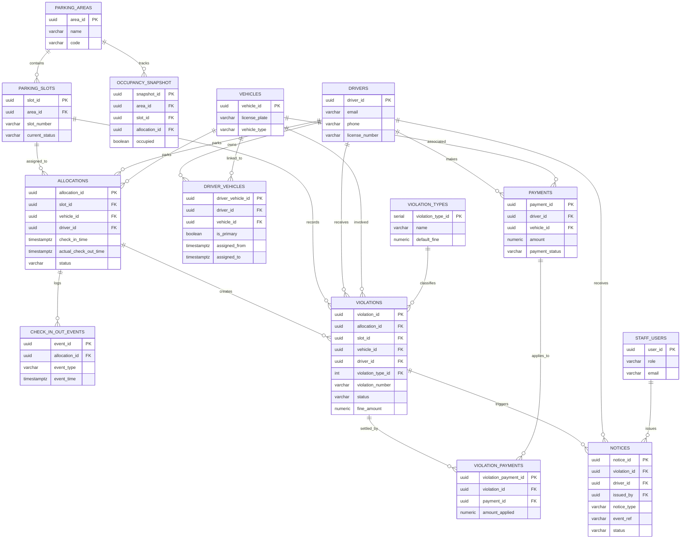

# Smart Parking Allocation & Violation Management System

## 1. Final business decisions

This schema reflects the final agreed rules:

1. Driver-vehicle relationships are historical and support many-to-many mappings through `driver_vehicles`.
2. Violations are generated automatically by application logic after a rule is evaluated.
3. A violation can only be created for an ACTIVE allocation. Historical allocations are rejected.
4. One payment can settle multiple violations through `violation_payments`.
5. Notices are generated automatically when a condition is met (for example: violation issued, overdue fine, payment reminder, or dispute notice).
6. Roles are restricted to `admin` and `parking_staff`.

Important note: PostgreSQL functions are helper APIs. They are not considered automatically triggered without explicit application or scheduler invocation.

## 2. Role split

### Developer A: Parking and allocation module
- parking_areas
- parking_slots
- drivers
- vehicles
- driver_vehicles
- allocations
- check_in_out_events
- occupancy_snapshot

### Developer B: Violation and payment module
- violation_types
- violations
- payments
- violation_payments
- notices
- audit_outbox

## 3. Database assumptions

The following assumptions are documented explicitly:

- A driver may own or use multiple vehicles over time; `driver_vehicles` preserves historical transfer data.
- A parking slot can host only one active allocation at a time.
- A vehicle can be assigned to only one active allocation at a time.
- A violation is always linked to an allocation, a slot, a vehicle, and a driver.
- The violation snapshot fields are retained intentionally so the record remains query-friendly even if the allocation changes later.
- Payment status and notice status are separate concepts and stored separately.
- MongoDB stores audit logs; PostgreSQL remains the transactional source of truth.

## 4. ER diagram



## 5. Table design summary

### parking_areas
Stores parking facilities, capacity, location, and operational state.

### parking_slots
Represents each slot and tracks current operational status.

### drivers
Stores driver master data, including name, email, phone, and license number.

### vehicles
Stores the vehicle master data and current operational status.

### driver_vehicles
Stores historical mapping between drivers and vehicles, including transfer start and end dates.

### allocations
Captures a single parking session. This is the core active record for occupancy and enforcement.

### check_in_out_events
Stores detailed check-in/check-out attempts and system-supplied events.

### occupancy_snapshot
Stores occupancy state snapshots for dashboard reporting.

### violation_types
Lookup table of possible violation categories and default fines.

### violations
Stores each violation and keeps snapshot values such as driver, vehicle, slot, and allocation at the time of creation.

### payments
Stores each payment transaction, amount, and payment status.

### violation_payments
Supports many-to-many settlement logic between one payment and multiple violations.

### notices
Stores notices such as fines, reminders, overdue letters, and dispute notices.

### audit_outbox
Stores pending PostgreSQL business events to be relayed to MongoDB.

## 6. Automatic violation generation rules

Violations are not created by the database without an explicit application-level decision.

The database contains the helper function:
- `create_violation_for_allocation(...)`

This function is valid only when:
- the allocation exists,
- the allocation status is `active`,
- the violation type exists,
- the application has already evaluated that a rule condition occurred.

Examples of rule conditions that may trigger violation generation:
- vehicle stayed beyond expected checkout time
- vehicle parked in an unauthorized area or slot
- vehicle occupied a blocked or reserved slot
- repeated invalid check-in or occupancy mismatch
- system-detected overstay or misuse

Important separation:
- PostgreSQL protects data integrity and validates the allocation state.
- The application or rule engine decides when the rule condition occurred and calls the function.
- PostgreSQL does not automatically generate violations based on arbitrary unbounded events without explicit invocation.

## 7. Automatic notice generation rules

Notices are created by application logic after a relevant event or condition is detected.

Examples:
- a new violation is created -> issue a fine notice
- a violation remains unpaid after the due date -> overdue notice
- a payment is pending -> payment reminder notice
- a dispute case is raised -> dispute notice

The schema prevents duplicate notices for the same event using:
- `notices.event_ref`
- `UNIQUE (violation_id, notice_type, event_ref)`

This ensures the same violation + notice type + event cannot create duplicate notice records.

Notice status remains independent from payment status.
- `notices.status` tracks communication state
- `payments.payment_status` tracks transaction outcome

## 8. Payment integrity rules

The payment relationship supports one payment to multiple violations:
- `payments` stores the original payment transaction
- `violation_payments` links the payment to one or more violations
- `amount_applied` stores the portion assigned to each violation

The schema guarantees:
- total applied against a violation cannot exceed the outstanding fine
- total applied against a payment cannot exceed the payment amount
- two concurrent transactions cannot bypass this because both the payment and violation rows are locked with `SELECT ... FOR UPDATE` before validation

This is implemented in the trigger and helper function logic.

## 9. Shared schema consistency

This database was designed to be internally consistent and separation-friendly:

- Member A owns the operational parking tables.
- Member B owns violation, payment, and notice tables.
- Shared keys such as `driver_id`, `vehicle_id`, `slot_id`, `allocation_id`, and `area_id` are common contract IDs.
- Violations store snapshot values intentionally so reporting does not require re-joining active records every time.

## 10. MongoDB audit logging and outbox design

MongoDB is used for audit logs only.

### Collection: audit_logs
Example document:

```json
{
  "_id": { "$oid": "..." },
  "audit_id": "uuid",
  "event_type": "violation_created",
  "entity_type": "violations",
  "entity_id": "uuid",
  "actor_type": "system",
  "actor_id": "parking-rule-engine",
  "occurred_at": "2026-11-02T08:00:00Z",
  "driver_id": "uuid",
  "vehicle_id": "uuid",
  "allocation_id": "uuid",
  "slot_id": "uuid",
  "area_id": "uuid",
  "payload": {
    "fine_amount": 500,
    "status": "open"
  },
  "summary": "Violation created for active allocation"
}
```

### PostgreSQL outbox
The `audit_outbox` table is used so that PostgreSQL inserts an event record first and sends it to MongoDB afterward.

This ensures:
- event data is retained if MongoDB is temporarily unavailable
- business transactions remain consistent with auditing
- audit events are not silently lost

## 11. Indexes and DBMS concepts implemented

The schema includes indexes for:
- slot status lookup
- active allocation queries
- vehicle and driver allocation history
- violation search and reporting
- payment lookup and payment-violation linking
- notice lookup and duplicate prevention
- pending audit outbox rows

The schema also demonstrates:
- primary keys and foreign keys
- CHECK constraints and UNIQUE constraints
- triggers for updated_at and allocation rules
- concurrency-safe validation using row locking (`FOR UPDATE`)
- transactional outbox pattern for MongoDB integration

## 12. Test and execution notes

This schema was reviewed and aligned with the final rules, but it was not executed successfully in this environment because PostgreSQL connection authentication is not available on port 5433.

Expected PostgreSQL testing commands (run once credentials are available):

```bash
createdb -h localhost -p 5433 -U postgres smart_parking_db_test
psql -h localhost -p 5433 -U postgres -d smart_parking_db_test -f database/schema.sql
psql -h localhost -p 5433 -U postgres -d smart_parking_db_test -c "\dt"
psql -h localhost -p 5433 -U postgres -d smart_parking_db_test -c "SELECT * FROM parking_areas;"
```

## 13. Member A implementation and setup

Apply the core schema first, then `advanced_features.sql`, then
`migrations/002_integrity_hardening.sql`. The advanced script adds the normalized
`driver_phones` table, authoritative area occupancy view, slot/allocation
synchronization triggers and `calculate_parking_fee(...)`. `seed.sql` adds
non-production demonstration areas, drivers and vehicles.

`tests/member_a_smoke.sql` verifies occupied-slot synchronization, duplicate
allocation rejection, fee rounding and slot release. It rolls back all fixture
data when successful. The Next.js dashboard uses the same database objects for
its occupancy, driver, vehicle and allocation views.

## 14. Remaining decisions to confirm

These are still project-level decisions that should be confirmed before implementation:

1. Should the application log each parking-rule event separately, or only the resulting violation/notice?
2. Should notices be generated automatically for all violations or only for unpaid or overdue violations?
3. Should a payment be allowed to settle multiple violations across different vehicles or only within the same vehicle context?
4. Should `trigger` logic be used for any business rules beyond allocation integrity and payment validation?

## 15. Final note

This schema is suitable for a college DBMS mini-project and is designed for a two-person team with clear ownership boundaries. It keeps the project understandable, consistent, and realistic while still demonstrating important database concepts.
