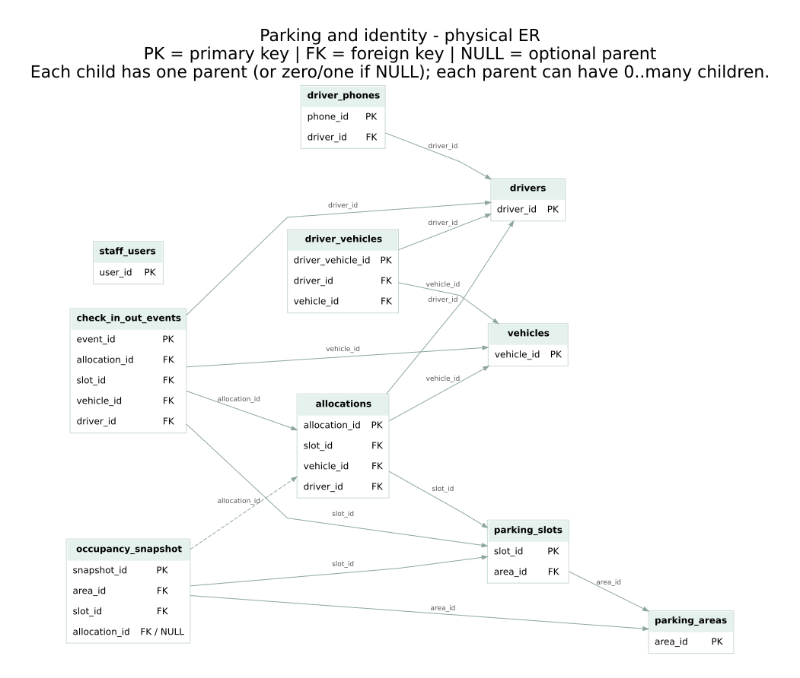
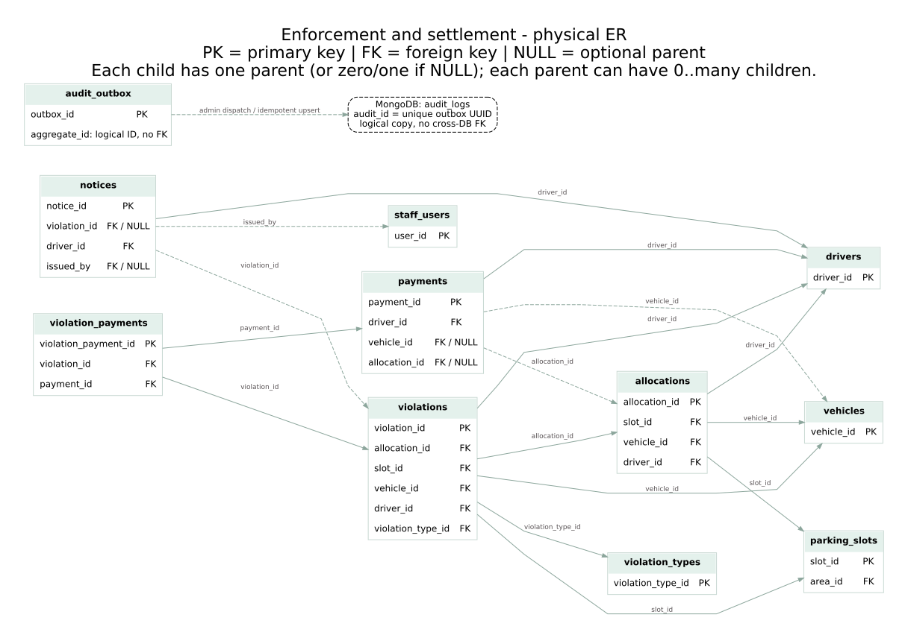

# Physical ER diagrams

These two views cover all 16 PostgreSQL tables after `schema.sql` and `advanced_features.sql`. Shared entities repeat between views to keep their references visible. Only key fields are shown; use the SQL and [data dictionary](../data-dictionary.md) for all attributes and constraints.

## Parking and identity



[Open full-size SVG](parking-er.svg) | [Editable Graphviz source](parking-er.dot)

## Enforcement, settlement and audit



[Open full-size SVG](enforcement-er.svg) | [Editable Graphviz source](enforcement-er.dot)

## Notation and scope

- Arrows run from child FK to referenced parent. A parent may have zero or many child rows. Each child references exactly one parent unless the FK is marked NULL (zero or one parent).
- Solid lines are required FKs; dashed relational lines are nullable FKs. PK/FK labels name the actual columns. Optionality describes the SQL schema, not extra application restrictions.
- Payment allocation is nullable at the column level, but a CHECK requires it for parking_fee and forbids it for violation_fine.
- `audit_outbox.aggregate_id` and MongoDB audit references are logical IDs, not SQL foreign keys. The dashed MongoDB arrow denotes delivery only. `parking_area_occupancy` is a derived view, not another stored entity.
- `occupancy_snapshot` is optional history and is not written by current app routes. `check_in_out_events.created_by` is a string, not an FK to staff.
- This is the physical design. Shared snapshot keys on violations/events are intentional; there is no implied normalization claim for those copies.

## Re-render

With Graphviz installed, run from the project root:

```bash
dot -Tsvg docs/diagrams/parking-er.dot -o docs/diagrams/parking-er.svg
dot -Tsvg docs/diagrams/enforcement-er.dot -o docs/diagrams/enforcement-er.svg
```

No application dependency is required. Review diagram source against SQL whenever adding or changing a foreign key. These are schema diagrams, not application screenshots.
